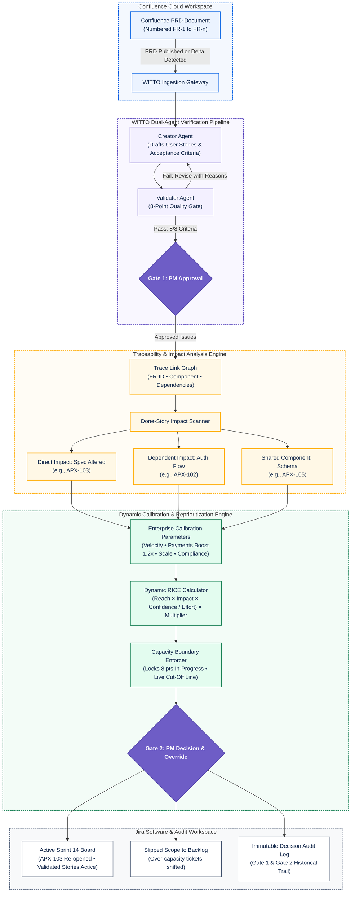

```
  ██╗    ██╗██╗████████╗████████╗ ██████╗ 
  ██║    ██║██║╚══██╔══╝╚══██╔══╝██╔═══██╗
  ██║ █╗ ██║██║   ██║      ██║   ██║   ██║
  ██║███╗██║██║   ██║      ██║   ██║   ██║
  ╚███╔███╔╝██║   ██║      ██║   ╚██████╔╝
   ╚══╝╚══╝ ╚═╝   ╚═╝      ╚═╝    ╚═════╝ 
```

### Multi-Agent Product Intelligence & Autonomous Traceability for Jira & Confluence

*An interactive enterprise research prototype demonstrating how dual AI agents convert Confluence requirements into validated Jira issues, detect regression impact across completed work, resolve backlog clashes, and calibrate annual strategic roadmaps—with the Product Manager holding final decision authority.*

---

[Executive Overview](#-executive-overview) • [Core Problem & Gap Analysis](#-core-problem--gap-analysis) • [System Architecture](#-system-architecture) • [Dual Interactive Scenarios](#-dual-interactive-scenarios) • [Smart WalkMe Companion](#-smart-walkme-companion) • [Engineering Team & Attribution](#-the-great-lakers-squad) • [Quickstart](#-quickstart)

---

## 📌 Executive Overview

In fast-paced product environments, requirements evolve continuously. When changes occur in Confluence, engineering teams frequently build tickets based on obsolete specifications, unknowingly break completed functionality, and manually negotiate sprint capacity in high-friction meetings.

**WITTO** is an autonomous multi-agent product intelligence assistant embedded directly within the Atlassian ecosystem. Operating across Jira and Confluence, WITTO eliminates requirements drift through:

1. **Dual-Agent Spec Conversion (F1):** A **Creator Agent** drafts structured Jira user stories from numbered Confluence PRDs, while an independent **Validator Agent** enforces an 8-point quality checklist before stories enter Jira.
2. **Dynamic Backlog Reprioritization & Impact Detection (F2):** When a requirement changes mid-sprint, WITTO scans completed stories (`Done`) using trace links, highlights code conflicts, surfaces open bug clashes, and dynamically recalculates RICE rankings within a capacity cut-off line.
3. **Strategic Portfolio Intelligence (Scenario 2):** Transforms high-level quarterly and annual Confluence PRDs into an interactive **2×2 Value vs. Effort Prioritization Matrix** calibrated against company scale, engineering velocity, and regulatory mandates (e.g., RBI DPDP Act 2023, PCI-DSS v4.0.1).

> **Academic & Empirical Context:** This system was created as an Empirical Research Project by the PGPM Class of 2027 at **Great Lakes Institute of Management, Chennai**, evaluating the efficacy of autonomous multi-agent verification in software delivery.

---

## 🎯 Core Problem & Gap Analysis

```
 CONFLUENCE PRD                   JIRA WORKSPACE                  RELEASE & PRODUCTION
┌──────────────────┐             ┌──────────────────┐             ┌───────────────────┐
│ Free-text PRD    │  Manual     │ Fragmented       │  Blind      │ Hidden Regression │
│ Missing criteria │ ──────────► │ Tickets          │ ──────────► │ Broken Done Work  │
│ Unnumbered reqs  │ Conversion  │ Unverified Scope │ Delivery    │ Costly Hotfixes   │
└──────────────────┘             └──────────────────┘             └───────────────────┘
         ▲                                ▲                                 ▲
         └────────────────────────────────┴─────────────────────────────────┘
                     WITTO CLOSED-LOOP TRACEABILITY MATRIX
```

### The Broken Chain (AS-IS vs. TO-BE with WITTO)

| Phase | AS-IS Industry Practice | Failure Mode | WITTO TO-BE State | Addressed Gap |
|---|---|---|---|---|
| **1. Spec Authoring** | Free-text unstructured notes in Confluence | Ambiguous scope, missing acceptance criteria | Structured template with numbered requirements (`FR-1`, `FR-2`) | **G1: Unstructured Input** |
| **2. Ticket Creation** | BA/PM manually writes Jira stories | Subjective interpretation, omitted edge cases | **Creator Agent** drafts standardized stories with role, goal, and reason | **G2: Manual Translation** |
| **3. Verification** | Informal peer review or none | 16–77% of AI-written stories fail quality thresholds | **Validator Agent** runs an 8-point checklist over a maximum of 2 revision rounds | **G3: Zero Verification** |
| **4. Traceability** | Missing links between PRD and tickets | Code disconnects from functional specifications | Automated bidirectional trace links: `Requirement ID`, `Component`, and `Dependencies` | **G4: Broken Trace Links** |
| **5. Requirement Delta** | Mid-sprint changes discussed in ad-hoc calls | What gets pushed out of scope remains invisible | **Dynamic RICE Re-ranking** with locked in-progress work and live capacity cut-off line | **G5: Guesswork Capacity** |
| **6. Downstream Impact** | Memory-based searches by QA/Devs | Broken completed features surface late in QA or production | **Automated Done-Story Impact Scan** (Direct, Dependent, Shared Component) | **G6: Hidden Regressions** |
| **7. Governance** | Undocumented decisions made in chat/meetings | Zero accountability or audit trail | **Immutable Decision Audit Log** recording PM approvals at Gates 1 & 2 | **G7: Undocumented Changes** |

---

## 🧠 System Architecture

WITTO utilizes a multi-agent state machine orchestrated across two strict human-in-the-loop decision gates:



---

## 🎬 Dual Interactive Scenarios

The prototype features two production-grade workflows addressing operational and strategic product leadership:

```
┌────────────────────────────────────────────────────────────────────────────────────────────────────────┐
│                                           SELECT SCENARIO                                              │
├───────────────────────────────────────────┬────────────────────────────────────────────────────────────┤
│ ⚡ SCENARIO 1: SPRINT AGILITY & DELTA     │ 🎯 SCENARIO 2: STRATEGIC ROADMAP & PORTFOLIO               │
│ Mid-sprint requirement change in PRD      │ Clean annual PRD authoring from scratch                    │
│ • Detects broken Done work (APX-103)      │ • 8 strategic candidate initiatives                        │
│ • Bug clash detection (APX-109)           │ • Calibrates against Series C scale & velocity (360 pts/Q) │
│ • Drag-and-drop RICE sprint reprioritize  │ • Interactive 2×2 Value vs. Effort Matrix                  │
│ • Capacity cut-off line (30 pts capacity) │ • Statutory compliance checks (RBI DPDP Act, PCI-DSS v4)   │
│ • Point steppers (-/+) & PM inline notes  │ • Automated Jira Roadmap Epics generation (Q1-Q4)          │
└───────────────────────────────────────────┴────────────────────────────────────────────────────────────┘
```

### ⚡ Scenario 1: Sprint Agility & Requirement Delta

Simulates an active sprint (**Sprint 14** of *ApexPay Enterprise*) when an enterprise customer requests resilient payment retry capabilities.

```
Jira Sprint 14 ──► Confluence PRD ──► Edit FR-3 ──► WITTO Pipeline ──► PM Adjustments ──► Jira Sync
  (11 tickets)       (FR-1 to FR-5)    (1 ➔ 3 retries)   (5-step agent)     (Drag & steppers)   (Gate 2 Log)
```

#### 1. Baseline Sprint 14 Snapshot (`ApexPay Enterprise` - `APX`)
- **Sprint Capacity:** 30 Story Points.
- **Locked In-Progress Work:** 8 Story Points (`APX-106` Saved Cards [5 pts], `APX-107` Decline Modal Copy [3 pts]). *In-progress tickets are never shifted automatically.*
- **Available Sprint Capacity:** 22 Story Points.

#### 2. The Requirement Delta (`FR-3`)
The client modifies **FR-3** in Confluence:
> **Original Text (FR-3):**  
> `If payment fails, allow the customer one retry with the same card.`  
>  
> **Updated Client Text (FR-3):**  
> `If payment fails, allow up to 3 retries and offer UPI or a wallet as fallback.`

#### 3. WITTO Multi-Agent Output
- **Requirement Extraction:** Automatically discovers implicit functional requirement **FR-9** (*UPI / Wallet fallback on decline*).
- **Completed Story Impact Matrix:**
  - `APX-103` (*Single retry trigger*, Done) → **Direct Impact** → Action: `Re-open in Sprint 14`
  - `APX-102` (*3-D Secure card pay*, Done) → **Dependent Impact** → Action: `Review & Re-test`
  - `APX-105` (*Receipt breakdown & GSTIN*, Done) → **Shared Component** → Action: `Regression Test`
- **Clashes with Open Work:**
  - **Open Bug (`APX-109`):** *Duplicate charge on retry timeout*. Increasing retries from 1 to 3 multiplies financial exposure. **WITTO elevates this bug to Rank #1.**
  - **In-Progress Task (`APX-107`):** *Decline modal copy*. Hardcoded to state "one retry". Flagged for developer communication; locked in place.
- **New Drafted & Validated Stories:**
  1. `Allow up to 3 automatic payment retries with idempotency` (5 pts, `FR-3`) → **Passed 8/8**
  2. `Present UPI deep-link and wallet fallback on card decline` (8 pts, `FR-9`) → **Passed 8/8**
  3. `Enforce fraud rate-limits and card lockout after 3 failures` (3 pts, `FR-3`) → **Passed 8/8 (Round 2)**
- **Interactive PM Controls:**
  - **Drag Handles (`⋮⋮`) & `▲`/`▼` Buttons:** PM can adjust priority rankings manually.
  - **Effort Stepper (`-`/`+`):** PM can adjust story estimates on the fly; RICE scores recalculate live.
  - **Capacity Cut-Off Line:** Live red dashed separator recalculates dynamically. Stories exceeding 22 points slip into the backlog.
  - **PM Inline Notes:** Captures qualitative rationale recorded in the audit log.

---

### 🎯 Scenario 2: Strategic Roadmap & Portfolio Intelligence

Simulates executive portfolio planning where a Product Manager authors an annual strategic PRD and leverages WITTO to balance resources, business value, and statutory constraints.

```
Blank Confluence ──► Insert FY27 PRD ──► Standard Spec ──► WITTO Strategic AI ──► 2×2 Quadrant Matrix ──► Jira Epics
   (Empty Draft)      (8 Initiatives)    (No AI scores)    (Scale & Compliance)     (Interactive Drag)     (Q1-Q4 Roadmap)
```

#### 1. Calibration Parameters
- **Industry Sector:** Fintech Merchant Acquiring & Core Payments
- **Company Scale:** Series C • 240 Engineers • 6 Product Squads
- **Squad Velocity:** 120 story pts / month (~360 story pts / quarter)
- **Regulatory Deadlines:**
  - Digital Personal Data Protection (DPDP) Act 2023 Statutory Consent Mandate (Deadline: Q1 2027)
  - PCI-DSS v4.0.1 Mandatory Encryption Framework

#### 2. Candidate Initiatives Evaluated (8 Total)
1. **Cross-Border Multi-Currency FX Settlement Engine** (48 pts, Q1) • *Must Have*
2. **RBI DPDP Act 2023 Consent & Redaction Vault** (54 pts, Q1) • *Must Have (Legal Risk)*
3. **Smart Multi-Acquirer Payment Failover Router** (38 pts, Q2) • *Must Have*
4. **Offline QR Soundbox & Merchant POS Terminal SDK** (26 pts, Q2) • *Should Have*
5. **NPCI e-Mandate & UPI Recurring Subscriptions** (24 pts, Q2) • *Should Have*
6. **Developer Portal & Zero-Trust SDK v3.0 Overhaul** (20 pts, Q3) • *Should Have*
7. **Autonomous AI Fraud Anomaly ML Engine** (65 pts, Q3) • *Could Have (Strategic Bet)*
8. **CBDC Digital Rupee & Crypto Sandbox Explorer** (42 pts, Q4) • *Won't Have (Deprioritized)*

#### 3. WITTO Strategic Synthesis
- **Interactive 2×2 Value vs. Effort Matrix:** Grouped into *1. Must Do / Mandates*, *2. Strategic Bets*, *3. Quick Wins*, and *4. Deprioritize / Won't Do* with full drag-and-drop reassignment.
- **Sticky Notes & Qualitative Annotations:** PM can attach audit notes directly to the PRD.
- **Automated Jira Epic Creation:** On approval, WITTO generates `APX-EPIC-10` through `APX-EPIC-17` and populates the Jira Roadmap timeline across Q1–Q4 2027.

---

## 🤖 Smart WalkMe Companion

The walkthrough includes an intelligent, non-blocking onboarding agent ("Witto the Sprint Companion") engineered to avoid screen obstruction while guiding user testing:

```
┌──────────────────────────────────────────────┐
│  🤖 WITTO Guide [Scenario 1]     Step 3 of 5 │
│  Handle: [::: Draggable]       [⇄ Flip] [-]  │
├──────────────────────────────────────────────┤
│ ✦ WHAT HAPPENED                              │
│   Requirement FR-3 is now in edit mode.      │
│                                              │
│ 💡 WHY IT MATTERS                            │
│   Client requested 3 retries and UPI.        │
│                                              │
│ 🎯 TARGET ACTION                             │
│   Click "✦ Insert Client Wording".           │
├──────────────────────────────────────────────┤
│  [Reset]               [ ⚡ Do it for me ]   │
└──────────────────────────────────────────────┘
```

### Architectural Features:
- **Smart Collision Avoidance:** Dynamically calculates target element bounding boxes (`getBoundingClientRect`) and snaps to the opposite side of the screen (left or right) to prevent covering active inputs.
- **Full Draggability:** Users can drag the companion anywhere across the viewport via the top header handle.
- **"⚡ Do it for me" Execution:** Users can click target elements manually or trigger automated step completion directly from the guide.
- **Compact Pill Docking:** Collapses into a floating purple pill badge (`🤖 WITTO Guide • Step 1/5`) with one click.
- **Pulsating Radar Beacon:** Injects non-blocking radar pulses (`.walkme-target-spotlight`) highlighting exact interactive targets.

---

## 🎨 Design System & Visual Hierarchy

The interface combines the precision of **Linear** with the familiarity of **Atlassian Jira and Confluence**:

- **Canvas:** Warm off-white (`#F9FAFB`), clean elevated white cards (`#FFFFFF`), hairline borders (`#E2E5EA`).
- **Color Palette:**
  - Brand Purple: `#6E5DC6` (WITTO Intelligence)
  - Atlassian Blue: `#0C66E4` (Jira Primaries)
  - Deep Slate: `#172B4D` (High-contrast typography)
  - Muted Slate: `#626F86` (Metadata and labels)
  - Alert Red: `#E5493A` (Bugs, clashes, and capacity cutoffs)
  - Success Teal: `#1F845A` (Validated criteria and passes)
- **Authentic Jira Issue Icons:** Uses genuine Atlassian SVG issue types:
  - 🟢 **Story:** Green bookmark ribbon with folded corner
  - 🔴 **Bug:** Red circular badge with insect glyph
  - 🔵 **Task:** Blue square with checkmark glyph
  - 🟣 **Epic:** Purple rounded square with lightning bolt

---

## 👥 The "Great Lakers" Squad

This prototype was conceptualized, designed, and developed as an **Empirical Research Project** by PGPM students at the **Great Lakes Institute of Management, Chennai (Class of 2027)**.

| Team Member | Primary Role | Core Focus Area |
|---|---|---|
| **Haripriya M** | **Tech Lead** | Agent Pipeline Architecture & Traceability Engine |
| **Pavitra Poojary** | **Senior UI Designer** | Linear & Atlassian Design System, Micro-interactions |
| **Jean Roderick A** | **Senior Backend Engineer** | State Management, RICE Engine, Capacity Logic |

**Academic Mentorship:**  
**Prof. Vivek N.**  
*Faculty Mentor & Advisor • Great Lakes Institute of Management, Chennai*

### Simulated Organization Personas:
- **Ananya Iyer (`PM`):** Lead Product Manager • *Final approval authority at Gate 1 and Gate 2*.
- **Rhea Sharma (`BA`):** Senior Business Analyst • *Spec refinement and requirements quality assurance*.

---

## 📐 Technical Specifications & Calibration Formulas

### 1. Dynamic RICE Formula with Domain Multiplier

$$
\text{RICE Score} = \left( \frac{\text{Reach} \times \text{Impact} \times \text{Confidence}}{\text{Effort (Story Points)}} \right) \times \text{Domain Multiplier}
$$

- **Reach ($R$):** Thousands of impacted users per quarter (1–50).
- **Impact ($I$):** Evaluated from 1 (Low) to 3 (Massive).
- **Confidence ($C$):** Percentage confidence factor (0.5 to 1.0).
- **Effort ($E$):** Estimated story points (Fibonacci: 1, 2, 3, 5, 8, 13).
- **Domain Multiplier ($M$):** `1.2×` for payment resilience & RBI compliance initiatives; `1.0×` baseline.

### 2. Capacity Boundary Rules

$$
\text{Free Capacity} = \text{Sprint Capacity (30)} - \sum \text{Locked In-Progress Points (8)} = 22\text{ pts}
$$

$$
\text{Eligible Story Points} = \sum_{k=1}^{n} \text{Story } k \le 22\text{ pts}
$$

*Any story falling at index $n+1$ where accumulated effort exceeds 22 points is dropped below the **Capacity Cut-Off Line** and marked as `Slipped to Backlog`.*

### 3. Validator Agent 8-Point Checklist

| Check # | Validation Rule | Pass Criteria |
|---|---|---|
| **1** | Requirement Coverage | Every `FR-n` has at least one associated Jira issue. |
| **2** | Invented Scope Prevention | No story exists without a direct parent `FR-n` link. |
| **3** | Work Hierarchy | Correct issue type selected (Story, Task, Bug, Epic). |
| **4** | Agile Story Format | Contains explicit *User Role*, *Action Goal*, and *Business Reason*. |
| **5** | Single Responsibility | Exactly one goal per story (stories with multiple goals fail). |
| **6** | Acceptance Criteria | Includes at least two testable, unambiguous criteria. |
| **7** | Sprint Feasibility | Story points $\le 8$ (items $> 8$ points must be split into tasks). |
| **8** | Traceability Metadata | Contains valid `FR-ID`, `Component`, and `Dependencies`. |

---

## 🚀 Quickstart

The prototype is distributed as a **zero-dependency, single-file application**. No build steps, package managers, or server installations are required.

```bash
# Clone the repository
git clone https://github.com/great-lakers/witto-product-intelligence.git
cd witto-product-intelligence

# Option A: Open directly in your browser
open witto-prototype.html       # macOS
xdg-open witto-prototype.html   # Linux
start witto-prototype.html      # Windows

# Option B: Run a local static server (recommended)
python3 -m http.server 8080
# Navigate to: http://localhost:8080/witto-prototype.html
```

### Browser Compatibility:
- Google Chrome 110+
- Apple Safari 16+
- Mozilla Firefox 115+
- Microsoft Edge 110+

---

## 🔬 Empirical Research Hypotheses

| Metric | Baseline (Manual BA/PM) | WITTO Multi-Agent Target | Validation Method |
|---|---|---|---|
| **Spec-to-Ticket Conversion Time** | 4.5 hours / PRD | $< 3$ minutes / PRD | Timed qualitative observation |
| **Downstream Impact Recall** | 38% of broken dependencies caught before QA | $> 92\%$ caught before sprint lock | Planted dependency test cases |
| **Story Acceptance Without Edits** | 52% accepted by PM | $> 84\%$ accepted without re-drafting | PM Gate 1 acceptance logs |
| **Reprioritization Consensus Time** | 45-minute sync meeting | $< 2$ minutes in-tool review | User testing stopwatch logs |

---

## 📄 License & Intellectual Property

This prototype is created for **academic and user research purposes** under the PGPM program at **Great Lakes Institute of Management, Chennai**.

*Visual design patterns, icons, and styling are inspired by the Atlassian Design System and Linear. WITTO is an independent research prototype and is not officially affiliated with or endorsed by Atlassian Pty Ltd.*